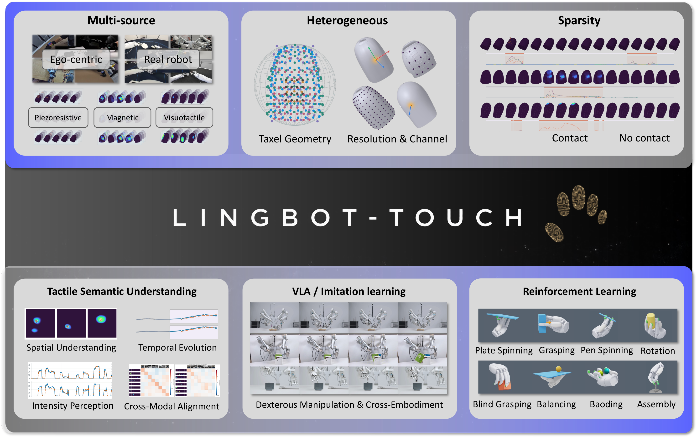
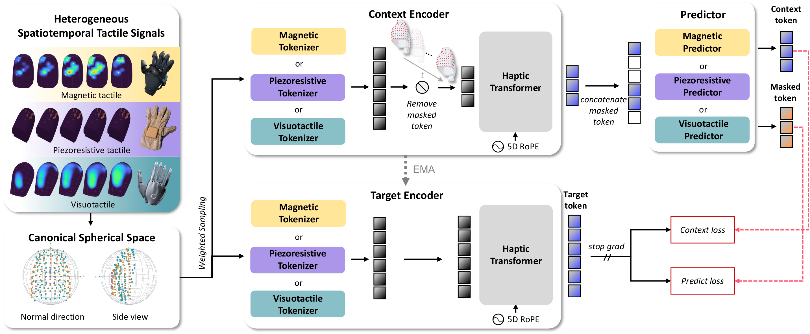

# LingBot-Touch: A Foundation Model for Heterogeneous Tactile Representation Learning

<p align="center">
  Bing Han, Yichuan Peng, Haoyu Dong, Yuanmeng Hu, Yongyi Jia, Fangjing Wang, Kecheng Zheng,<br>
  Yiming Zhang, Yanhong Zeng, Xiaoqing Zhang, Chen Song, Rundong Zou, Anqi Dong,<br>
  Yuan Guan, Ka Leong Cheng, Xing Zhu, Yujun Shen, Nan Xue, Wei Ning<sup>†</sup>
</p>

<p align="center">
  <a href="paper/Learning_Heterogeneous_Tactile_Representation_for_General_Dexterous_Manipulation.pdf"></a>
  
  <a href="https://huggingface.co/robbyant/lingbot-touch"></a>
  <a href="https://modelscope.cn/models/Robbyant/lingbot-touch"></a>
  <a href="LICENSE"></a>
</p>

<p align="center">
  
</p>

We aim to bridge heterogeneous tactile sensor signals and real-world dexterous robotic manipulation, enabling tactile experience to transfer across hardware platforms and tasks. To this end, we introduce **LingBot-Touch**, a JEPA-based tactile representation model built around a shared Transformer and latent representation prediction from spatiotemporal tactile context. LingBot-Touch enables a rich understanding of spatiotemporal tactile signals across sensing modalities while supporting high-frequency inference and cross-task transfer.

We demonstrate four key properties:

1. **Unified.** Heterogeneous tactile data from multiple sources mutually enhance representation learning within a unified latent space.
2. **Transferable.** Even when pretrained on entirely different tactile sensors, LingBot-Touch transfers to downstream tactile sensors and real-world dexterous robotic hands without any additional training.
3. **Efficient.** Even with its smallest ViT backbone, LingBot-Touch supports high-frequency downstream inference with a lightweight architecture.
4. **Scalable.** Scaling the amount of tactile training data yields continued performance improvements on both downstream tactile tasks and real-world robotic manipulation tasks.

## Contents

- [Pretraining](#LingBot-Touch-Pre-Training)
- [Open Weights](#Models)
- [Usage of LingBot-Touch Representations](#Usage-of-LingBot-Touch-Representations)
- [Getting Started](#Getting-Started)
- [Environment Setup](#Environment-Setup)
- [Inference Steps](#Inference-Steps)
- [Example](#Example)
- [License](#License)
- [Citation](#Citation)
- [Detailed Data Interface Guide](#Detailed-Data-Interface-Guide)

## LingBot-Touch Pre-Training

<p align="center">
  
</p>

LingBot-Touch learns unified representations of magnetic, piezoresistive, and visuotactile signals through masked prediction in latent space, using modality-specific tokenizers and a shared Transformer. See the [paper](paper/Learning_Heterogeneous_Tactile_Representation_for_General_Dexterous_Manipulation.pdf) for method details.

**Inference release.** This repository provides the frozen target encoder and utilities for extracting token-level tactile features and their spatiotemporal addresses.

## Models

#### LingBot-Touch Pretrained Checkpoints

| **Model** | **ModelScope** | **Hugging Face** |
| --- | --- | --- |
| LingBot-Touch-Tiny | [Download](https://modelscope.cn/models/Robbyant/lingbot-touch/files?version=master&root=lingbot-touch-tiny) | [Download](https://huggingface.co/robbyant/lingbot-touch/tree/main/lingbot-touch-tiny) |
| LingBot-Touch-Small | [Download](https://modelscope.cn/models/Robbyant/lingbot-touch/files?version=master&root=lingbot-touch-small) | [Download](https://huggingface.co/robbyant/lingbot-touch/tree/main/lingbot-touch-small) |

Download the matching `config.json` and `encoder.pt` from either platform and place them in `checkpoints/lingbot-touch-tiny/` or `checkpoints/lingbot-touch-small/`. Model files are hosted separately from this source repository. Access requires an account with permission to the model repository.

## Usage of LingBot-Touch Representations

After extracting token-level tactile representations with LingBot-Touch, we strongly recommend **attention-based querying**: use learnable or task-conditioned queries to attend to all output tokens through cross-attention and retrieve information needed by the downstream task, rather than relying on a per-token linear projection or mean/max pooling as the default readout.

Each token retains its temporal, finger, and spatial address, but JEPA representations integrate spatiotemporal context: after self-attention in the shared Transformer, a token contains information from other taxels and time positions rather than an independent measurement of a single taxel. Selecting tokens by address or applying mean/max pooling therefore does not isolate information from a particular finger or time interval.

## Getting Started

First download a model bundle from the [checkpoint table](#Models). Use its matched `config.json` and `encoder.pt` together with this code. The three supported modalities are `magnetic`, `piezoresistive`, and `visuotactile`.

### Environment Setup

These commands use the verified Linux / Python 3.12 / PyTorch 2.11 environment. Run them from the repository or extracted release root, where `pyproject.toml` and `infer.py` are located:

```bash
conda create -n lingbot-touch python=3.12.13 pip=26.0.1 -y
conda activate lingbot-touch
python -m pip install "torch==2.11.0" --index-url https://download.pytorch.org/whl/cu130
python -m pip install .
python -m pip check
```

The installed distribution is `lingbot-touch`; Python imports use `tactile_jepa_inference` for the encoder and `data_interfaces` for sensor adapters. Installation includes the verified `numpy==2.4.4` dependency to avoid PyTorch's missing-NumPy warning.

The inference commands below use CPU. For a compatible NVIDIA GPU, replace `--device cpu` with `--device cuda:0`. See [the detailed guide](DATA_INTERFACE_GUIDE.md) for environment and device details.

### Inference Steps

&nbsp;Download model weights and configuration.<br>
&nbsp;Align the data format.<br>
&nbsp;Normalize geometry and signal values.<br>
&nbsp;Resample (optional, recommended).<br>
&nbsp;Select the sensing modality.<br>
&nbsp;Run inference to obtain representations.

The public sensing-modality interface provides three options: `modality="magnetic"`, `"piezoresistive"`, and `"visuotactile"`.

First, use [`normalize_positions`](data_interfaces/geometry.py) with verified fingertip spherical calibration parameters to transform the 3D taxel coordinates into canonical space. Then use [`prepare_sensor_input`](data_interfaces/interfaces.py), which calls [`normalize_signal`](data_interfaces/normalization.py), to normalize signal values with fixed sensor ranges: XY in `[-1,1]` and Z in `[0,1]`. For scalar visuotactile and piezoresistive signals, place the measurement in Z and set XY to zero.

Here, “calibration parameters” means a fixed geometric transform for each finger: `rotation` aligns coordinate directions, `coordinate_origin` specifies the reference origin after rotation, `radius` specifies the reference radius, and `offset_xyz` specifies the canonical-space offset. The computation is `p_canonical = (p @ rotation.T - coordinate_origin) / radius + offset_xyz`. These parameters come from complete taxel geometry and reference templates, not from current tactile values or individual clips, and do not project every point onto a unit sphere.

**The included examples do not require you to supply calibration parameters:** Sharpa samples already contain canonical coordinates; the XHand adapter includes fixed target coordinates and hand mappings. Do not apply another transformation. Only a new raw taxel layout requires verified geometry calibration; see [the detailed guide](DATA_INTERFACE_GUIDE.md). For XHand, raw-signal point selection precedes normalization and clipping, as shown below.

**Optional point sampling:**

Pretraining explicitly supports **96, 76, 64, 48, 32, 24** points per finger for magnetic sensing, **61, 16, 9** for piezoresistive sensing (**124 points for the thumb in the 61-point layout**), and **200, 96, 32** for visuotactile sensing. In our experience, resampling to a compatible sensor resolution and geometry can further improve representation quality. The package includes [sampling code](data_interfaces/sampling.py), [pretraining sampling maps](data_interfaces/pretraining_sampling.py), and [reference geometry](data_interfaces/data/multires_references_v1.json).

### Example

#### Example 1: Sharpa Wave → Visuotactile Branch

| Step | Code/input and result |
| --- | --- |
| <nobr>&nbsp;Model</nobr> | Download Tiny's `config.json` and `encoder.pt` into `checkpoints/lingbot-touch-tiny/`. |
| <nobr>&nbsp;Format</nobr> | Use the [Sharpa sample](sample_data/sharpa/001_left.pt): `raw` contains scalar tactile values of shape `[1,16,5,200]`, ordered thumb, index, middle, ring, pinky. These are not RGB images. |
| <nobr>&nbsp;Normalization</nobr> | The [Sharpa interface](data_interfaces/infer_sharpa.py) calls the [signal adapter](data_interfaces/interfaces.py) to produce `[0,0,clip(Z/255,0,1)]`. Samples already include correct canonical spherical coordinates and hand alignment; do not transform their geometry again. |
| <nobr>&nbsp;Sampling</nobr> | This example already has 200 points per finger and requires no further resampling. Other verified layouts may use the optional [sampling interface](data_interfaces/sampling.py). |
| <nobr>&nbsp;Branch</nobr> | The Sharpa interface automatically selects `modality="visuotactile"`. |
| <nobr>&nbsp;Representations</nobr> | Run the commands below to obtain separate token-feature files for the left and right hands. |

```bash
mkdir -p outputs/sharpa
for HAND in left right; do
  python infer.py --input-format sharpa \
    --bundle checkpoints/lingbot-touch-tiny \
    --input "sample_data/sharpa/001_${HAND}.pt" \
    --output "outputs/sharpa/001_${HAND}_features.pt" \
    --device cpu
done
```

For new data with sensor-space 3D coordinates, use the [geometry normalization code](data_interfaces/geometry.py) with verified calibration parameters. Input formats and `--calibration` usage are described in [the detailed guide](DATA_INTERFACE_GUIDE.md).

#### Example 2: XHand → Magnetic Branch

| Step | Code/input and result |
| --- | --- |
| <nobr>&nbsp;Model</nobr> | Reuse the two model files in `checkpoints/lingbot-touch-tiny/`. |
| <nobr>&nbsp;Format</nobr> | Use the [XHand sample](sample_data/xhand/001_left.pt): `raw` contains three-axis tactile values of shape `[1,16,5,120,3]`, with `hand` and a verified `layout_id`. |
| <nobr>&nbsp;Normalization</nobr> | The [XHand adapter](data_interfaces/xhand.py) converts point order and signal axes according to handedness, then normalizes by `[128,128,255]`, clipping XY to `[-1,1]` and Z to `[0,1]`. |
| <nobr>&nbsp;Sampling</nobr> | This example uses the existing 120→96 point-selection method and magnetic96 canonical coordinates, producing `[1,16,5,96,3]`. You can also use the original 120-point tactile data through the general sensor interface with matching canonical coordinates; we have verified that the 120→96 processing yields better representations. |
| <nobr>&nbsp;Branch</nobr> | The [XHand interface](data_interfaces/infer_xhand.py) automatically selects `modality="magnetic"`. |
| <nobr>&nbsp;Representations</nobr> | Run the commands below to obtain separate token-feature files for the left and right hands. |

```bash
mkdir -p outputs/xhand
for HAND in left right; do
  python infer.py --input-format xhand \
    --bundle checkpoints/lingbot-touch-tiny \
    --input "sample_data/xhand/001_${HAND}.pt" \
    --output "outputs/xhand/001_${HAND}_features.pt" \
    --device cpu
done
```

This mapping applies only to the verified XHand120 point-order and signal-axis conventions. If hardware or SDK changes the ordering, verify the mapping first; matching tensor shapes alone is insufficient.

#### Run All Samples and Read the Results

The [sample manifest](sample_data/manifest.json) indexes **30 bilateral input pairs per platform**, for both Sharpa and XHand, with 16 consecutive frames per hand: **120 single-hand input files** in total. See [the detailed guide](DATA_INTERFACE_GUIDE.md) for input contracts.

Run all samples:

```bash
for SENSOR in sharpa xhand; do
  mkdir -p "outputs/batch_${SENSOR}"
  for INPUT in "sample_data/${SENSOR}/"*.pt; do
    NAME=$(basename "$INPUT" .pt)
    python infer.py --input-format "$SENSOR" \
      --bundle checkpoints/lingbot-touch-tiny \
      --input "$INPUT" \
      --output "outputs/batch_${SENSOR}/${NAME}_features.pt" \
      --device cpu
  done
done
```

Existing output files are not overwritten; use a new output directory when rerunning. Read the first result from each batch output directory:

```python
import torch

for sensor in ("sharpa", "xhand"):
    result = torch.load(f"outputs/batch_{sensor}/001_left_features.pt", map_location="cpu", weights_only=True)
    print(sensor, result["latent"].shape)
    print(result["time_id"].shape, result["finger_id"].shape, result["pos_xyz"].shape)
```

`latent` contains token-level representations of shape `[B,N,C]`. `time_id`, `finger_id`, and `pos_xyz` identify each token's time, finger, and spatial location. `N` depends on frame count, tubelet size, and valid points; `C` is determined by the downloaded model configuration.

Package layout (top-level):

```text
lingbot-touch/
├── .gitignore
├── README.md
├── DATA_INTERFACE_GUIDE.md
├── LICENSE
├── THIRD_PARTY_NOTICES.md
├── pyproject.toml
├── infer.py
├── assets/
├── paper/
├── data_interfaces/
├── tactile_jepa_inference/
├── tests/
└── sample_data/
```

## License

LingBot-Touch is licensed under the [Apache License, Version 2.0](LICENSE). Applicable third-party components retain their original licenses; see [Third-Party Notices](THIRD_PARTY_NOTICES.md).

## Citation

The BibTeX entry will be added when the paper is available.

## Detailed Data Interface Guide

We provide a detailed [data interface guide](DATA_INTERFACE_GUIDE.md). Read it directly or share it with your Agent for help understanding and using the interfaces. Have fun!
